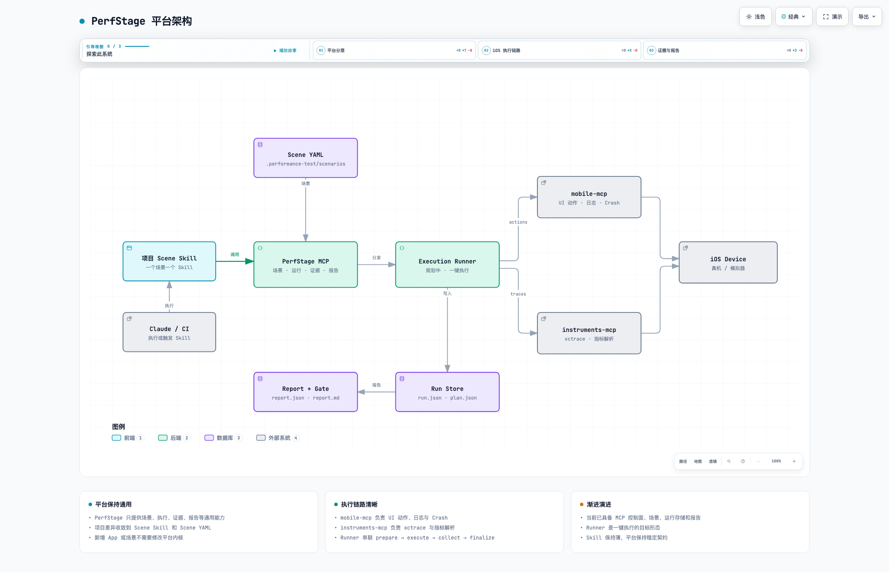
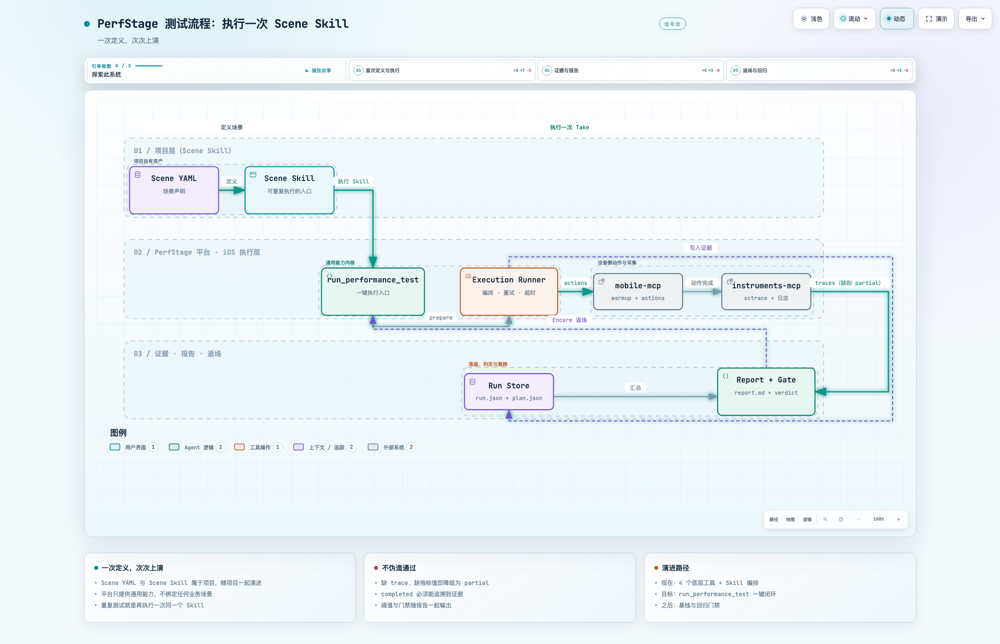

# PerfStage

**Define once. Perform every time.**
**一次定义，次次上演。**

PerfStage 是面向 iOS 的性能测试平台。它把 iOS 性能测试的通用能力收敛成一个稳定的 MCP 服务；每个接入项目基于这套能力，定义自己的测试场景和 Scene Skill。场景定义一次，之后每次回归只需要执行同一个 Skill。

> 平台是舞台，项目是剧目。PerfStage 提供灯光、音响和后台，项目负责写好自己的一场戏。

---

## 目录

- [1. 为什么是「平台 + 项目 Skill」](#1-为什么是平台--项目-skill)
- [2. 当前状态](#2-当前状态)
- [3. 快速开始](#3-快速开始)
- [4. 平台架构](#4-平台架构)
- [5. 一次 Take 的执行流程](#5-一次-take-的执行流程)
- [6. 项目 Scene Skill 契约](#6-项目-scene-skill-契约)
- [7. MCP 工具参考](#7-mcp-工具参考)
- [8. 场景 YAML 参考](#8-场景-yaml-参考)
- [9. 运行产物与报告](#9-运行产物与报告)
- [10. 状态语义](#10-状态语义)
- [11. 边界与路线图](#11-边界与路线图)
- [12. 常见问题](#12-常见问题)
- [13. 相关项目](#13-相关项目)

---

## 1. 为什么是「平台 + 项目 Skill」

不同 App 的性能场景差异很大：社区首页滚动、消息列表长按、直播间进出、启动首屏……这些知识属于业务，不属于平台。PerfStage 因此把职责分成三层：

| 层 | 归属 | 负责什么 |
| --- | --- | --- |
| **项目层** | 每个接入项目 | Scene YAML（场景定义）、Scene Skill（执行入口）、阈值与输出约定 |
| **平台层** | PerfStage | 场景解析、计划校验、运行生命周期、证据落盘、诊断归一化、报告生成 |
| **执行层** | iOS 工具链 | `mobile-mcp` 执行 UI 动作，`instruments-mcp-server` 采集 xctrace 与指标 |

这样分工带来两个直接好处：

- **平台不绑定业务。** 新增一个 App 或一个场景，不需要修改 PerfStage 内核。
- **重复测试成本极低。** 场景稳定后，回归就是「再执行一次 Skill」，而不是重新向助手描述一遍测试步骤。

### 命名约定

沿用舞台隐喻，文档和 Skill 中使用同一套词汇：

| 概念 | 叫法 | 说明 |
| --- | --- | --- |
| 平台 | **PerfStage** | 提供通用能力 |
| 项目场景 | **Scene** | 一个 YAML + 一个 Skill |
| 一次运行 | **Take** | 一次完整的测试执行 |
| 重复执行 | **Encore** | 复跑同一 Scene；阈值门禁已可用，历史对比规划中 |
| 项目场景集合 | **Repertoire** | 一个项目的全部 Scene |
| 报告 | **Scorecard** | `report.md` / `report.json` |

> 兼容性说明：运行时标识保持原样，MCP server 名仍是 `performance-test`，数据目录仍是 `.performance-test/`。PerfStage 是品牌与架构层，不要求迁移已有项目数据。

---

## 2. 当前状态

PerfStage 目前是一个**可用的控制面**，还不是完整的自动化执行平台。下面这张表区分「今天就能用」和「规划中」，避免把路线图当成现状。

| 能力 | 状态 | 说明 |
| --- | --- | --- |
| 场景加载与校验 | ✅ 可用 | YAML → TestPlan，未知动作直接报错 |
| 运行目录与证据落盘 | ✅ 可用 | 每次 Take 独立目录，路径边界与原子写 |
| 诊断归一化 | ✅ 可用 | 日志三态、Crash 差集、生命周期分类 |
| 证据门禁 | ✅ 可用 | 缺指标 / 缺值 / 缺 trace → `partial` + `gate=unknown` |
| 阈值判定与 `gate` | ✅ 可用 | 场景阈值自动推导 `pass` / `warn` / `fail` |
| 报告生成 | ✅ 可用 | `report.json` + 中文 `report.md` |
| 工作区隔离 | ✅ 可用 | 以项目为边界，不跨项目读写 |
| Skill 模板与契约 | ⏳ 规划中 | 本文第 6 节给出目标契约 |
| 一键执行 `run_performance_test` | ⏳ 规划中 | 目前由 Skill / Claude 按 `nextSteps` 编排 |
| 基线、历史对比 | ⏳ 规划中 | 当前只有单次报告与阈值门禁 |

**现在的真实执行链路是：**

```text
Scene Skill → list / prepare → 按 nextSteps 执行动作与采集 → finalize → report
```

**目标是：**

```text
Scene Skill → run_performance_test → 自动执行 + 采集 + 报告 + 门禁
```

在第 2 条落地之前，Skill 仍然需要负责编排 `mobile-mcp` 与 `instruments-mcp-server` 的调用顺序。本文档不会把规划中的能力写成已实现。

---

## 3. 快速开始

### 3.1 环境要求

- macOS
- Node.js 20 或更高版本
- 已配置可用的 `mobile-mcp`
- 已配置可用的 `instruments-mcp-server`
- 真机性能采集建议使用真实 iOS 设备；`Animation Hitches` 不支持模拟器

PerfStage 不启动、不实现另外两个 MCP，也不修改被测 App 源码。

### 3.2 构建与注册

```bash
cd "/Users/leigod/雷神/性能分析/performance-test-mcp"
npm install
npm test
npm run build
```

以用户级方式注册到 Claude Code，一次安装、所有项目复用同一个入口：

```bash
claude mcp add --scope user --transport stdio performance-test -- \
  node "/Users/leigod/雷神/性能分析/performance-test-mcp/dist/index.js"
```

检查连接：

```bash
claude mcp list
```

用户级注册只共享**二进制入口**，不共享数据。每个项目仍然拥有自己的 `.performance-test/`。修改代码后需要 `npm run build` 并重启会话。

### 3.3 初始化项目工作区

进入被测项目后，第一步永远是初始化：

```json
{
  "bundleId": "com.example.app",
  "appName": "Example App",
  "copyDefaultScenarios": false
}
```

- `bundleId` / `appName` 可选；不传则只创建默认目录。
- `copyDefaultScenarios: true` 会植入两个模板场景，适合首次试用。
- 初始化是**幂等**的，重复调用只重新校验，不覆盖已有配置与场景。

初始化后，项目的目录结构如下：

```text
<project>/
├── .performance-test/
│   ├── config.json
│   ├── scenarios/
│   │   └── community-home-scroll.yaml
│   └── runs/
└── .claude/
    └── skills/
        └── perf-community-scroll/
            └── SKILL.md
```

### 3.4 定义一个 Scene

把场景写进 `.performance-test/scenarios/`（完整格式见[第 8 节](#8-场景-yaml-参考)），然后为它写一个 Skill（见[第 6 节](#6-项目-scene-skill-契约)）。

### 3.5 执行

对 Claude 说：

```text
执行 perf-community-scroll
```

Skill 会完成一次 Take，并返回 `runId`、状态、指标、报告路径。需要回归时再说一次，就是一次 Encore。

---

## 4. 平台架构



- 交互式版本（可切换视图、明暗主题）：[`docs/diagrams/perfstage-architecture.html`](docs/diagrams/perfstage-architecture.html)
- 源文件：[`docs/diagrams/perfstage-architecture.json`](docs/diagrams/perfstage-architecture.json)

**读图要点：**

- **项目 Scene Skill** 是唯一入口。它属于项目，随项目一起版本化。
- **PerfStage MCP** 是通用能力层：加载场景、校验计划、管理运行、落盘证据、生成报告。
- **Execution Runner** 是规划中的执行器。它负责把 Skill 的一次调用展开为「执行动作 → 采集指标 → 收尾」，让重复测试不再依赖现场编排。
- **mobile-mcp / instruments-mcp** 是 iOS 执行层的两个适配器，分别负责 UI 动作与性能采集。
- **Run Store / Report + Gate** 是证据层。每次 Take 都写入独立目录，报告可追溯。

平台当前已具备图中实线部分；Runner 与门禁为规划中能力。

---

## 5. 一次 Take 的执行流程



- 交互式版本：[`docs/diagrams/perfstage-workflow.html`](docs/diagrams/perfstage-workflow.html)
- 源文件：[`docs/diagrams/perfstage-workflow.json`](docs/diagrams/perfstage-workflow.json)

一次 Take 分为四段：

1. **定义**：Scene YAML 描述 App、前置条件、warmup、actions、metrics；Scene Skill 描述如何执行它。
2. **执行**：调用 PerfStage MCP 创建运行，按计划驱动 `mobile-mcp` 完成 UI 动作。
3. **采集**：通过 `instruments-mcp-server` 获取 xctrace 与指标，同时保存日志、Crash 与生命周期证据。
4. **判定**：`finalize` 汇总证据、计算阈值门禁并生成报告。证据不足即降级为 `partial`（`gate=unknown`），指标超阈值则是 `completed` + `gate=fail`。

**返场（Encore）** 是同一个流程的再次执行。阈值门禁已经接在报告之后，规划中的基线对比会进一步判断本次相对历史是否回归。

---

## 6. 项目 Scene Skill 契约

Skill 是项目资产，不是平台资产。它应该足够短：只描述「测什么、在哪台设备上测、结果怎么算」，不重复平台的编排细节。

### 6.1 目录约定

```text
<project>/.claude/skills/perf-<scene>/
├── SKILL.md          # 必须
└── references/       # 可选：截图、预期结果、历史结论
```

### 6.2 输入契约

一个 Scene Skill 至少接收：

| 输入 | 必填 | 说明 |
| --- | --- | --- |
| `sceneId` | 是 | 对应 `.performance-test/scenarios/<sceneId>.yaml` |
| `deviceId` | 是 | 目标设备 UDID；不要写死在 YAML 里 |
| `analysisFocus` | 否 | 例如 `["jank", "memory"]`，覆盖场景默认值 |
| `baselineRunId` | 否 | 规划中：指定对比基线 |

### 6.3 输出契约

无论底层如何实现，Skill 最终都应返回同一组字段：

```json
{
  "runId": "2026-11-13T06-20-00.000Z-a1b2",
  "sceneId": "community-home-scroll",
  "status": "completed",
  "metrics": {
    "hitches": 3,
    "blockMs": 84.2,
    "launchMs": 274.3,
    "memoryMB": 113.5
  },
  "findings": [],
  "reportPath": ".performance-test/runs/<runId>/report.md",
  "gate": "pass"
}
```

- `status`：`completed` / `partial` / `failed` / `invalid` / `cancelled`
- `gate`：阈值门禁结果 `pass` / `warn` / `fail` / `unknown`

`status` 与 `gate` 回答两个不同问题：`status` 表示这次 Take 是否有效可信，
`gate` 表示指标是否达标。指标超过阈值时仍是 `status=completed` +
`gate=fail`，不会把测试本身判成 `partial`。

指标名使用 MVP 规范词表（`hitches` / `blockMs` / `launchMs` / `memoryMB`），
旧名 `memory`、`launch`、`blockingMs` 会被自动归一化。每个指标都应带
`tracePath`，否则证据门禁会认为本次 Take 不完整。

### 6.4 示例 `SKILL.md`

> 这是**当前可执行**的 Thick Skill 形态：Skill 负责编排，MCP 提供原语。等 `run_performance_test` 落地后，Skill 可以缩短为只调用一个工具。

```markdown
---
name: perf-community-scroll
description: 社区首页上下滚动性能测试。用于回归卡顿、CPU 与内存。
---

# 社区首页滚动性能测试

## 参数
- sceneId: community-home-scroll
- deviceId: 必填，向用户确认或从 mobile-mcp 设备列表中选择

## 步骤
1. 调用 `list_performance_scenarios`，确认 `community-home-scroll` 存在。
2. 调用 `prepare_performance_test`：
   `{ "scenarioId": "community-home-scroll", "device": { "id": "<deviceId>" } }`
3. 读取返回值中的 `plan`（完整解析计划已内联，包含
   `preconditions`、`warmup`、`actions`、`metrics`）。
4. 按 `nextSteps` 顺序执行：
   - 先启动设备日志，记录测试前 Crash 列表；
   - 用 `mobile-mcp` 依次执行 warmup 与 actions，遵守 `waitAfterMs`；
   - 用 `instruments-mcp-server` 采集 plan 中声明的每个指标，并记录 tracePath；
   - 采集执行后日志、Crash 差集与生命周期事件。
5. 调用 `finalize_performance_test`，提交 `runId`、`requestedStatus`、
   `actions`、`metrics`、`diagnostics` 与 `evidencePaths`。
6. 输出：`runId`、`status`、指标摘要、`reportPath`。
   若 `status` 不是 `completed`，明确列出缺失的证据。
```

### 6.5 编写 Skill 的三条规则

1. **不要伪造证据。** 没采到 trace 就如实报告，让状态降级为 `partial`。
2. **不要在 Skill 里写设备 UDID。** 设备是运行时参数，不是场景定义。
3. **不要把业务判断写进平台。** 阈值、关注点和结论属于项目，平台只负责计算与呈现。

---

## 7. MCP 工具参考

PerfStage 目前提供 4 个底层原语。它们稳定、可测试，也是未来 `run_performance_test` 的实现基础。

### `initialize_performance_workspace`

在当前项目创建或校验 `.performance-test/`。幂等，不覆盖已有数据。

### `list_performance_scenarios`

列出当前项目的场景：ID、名称、Bundle ID、动作数量、指标、诊断配置。无参数。

### `prepare_performance_test`

创建一次运行（`prepared` 状态），写入 `run.json` 和解析后的 `plan.json`，返回执行指引。

```json
{
  "scenarioId": "community-home-scroll",
  "device": { "id": "00008150-001E49E40128C01C", "name": "Ra iPhone" },
  "execution": "interactive",
  "analysisFocus": ["jank", "memory"]
}
```

返回字段：`runId`、`scenarioId`、`planId`、`runPath`、`planPath`、`plan`、`execution`、`analysisFocus`、`metricOverrides`、`nextSteps`。

`plan` 是完整解析后的 `TestPlan`，Skill 与 CLI 无需再读取文件布局即可执行本次 Take。

也可以传 `adHocPlan` 做一次性测试；临时计划不会自动沉淀为长期场景。

### `finalize_performance_test`

提交动作、指标和诊断证据，计算最终状态并生成报告。

```json
{
  "runId": "2026-11-13T06-20-00.000Z-a1b2",
  "requestedStatus": "completed",
  "actions": [
    {
      "actionId": "scroll-up-1",
      "outcome": "executed",
      "startedAt": "2026-11-13T06:20:10.000Z",
      "endedAt": "2026-11-13T06:20:11.500Z",
      "durationMs": 1500
    }
  ],
  "metrics": [
    {
      "name": "hitches",
      "value": 3,
      "unit": "frames",
      "verdict": "warn",
      "tracePath": "/tmp/community-hitches.trace"
    }
  ],
  "diagnostics": {
    "logText": "...device log text...",
    "crashIdsBefore": ["old-crash-id"],
    "crashIdsAfter": ["old-crash-id"],
    "crashReports": [],
    "lifecycle": [{ "kind": "foreground", "timestamp": "2026-11-13T06:20:00.000Z" }]
  },
  "evidencePaths": [
    { "kind": "deviceLog", "sourcePath": "/tmp/device.log", "relativePath": "device.log" }
  ],
  "notes": "重点观察减速尾段。"
}
```

规则：

- `requestedStatus` 必须是终态；`prepared` / `running` 会被拒绝。
- 证据会复制进运行目录，报告中只出现相对路径。
- 查询失败必须填写对应的 `*QueryError`，不能伪造为空结果。
- 新增 Crash、watchdog、jetsam、设备断连都会阻止结果被标记为普通成功。
- **证据门禁已强制**：计划中的指标必须全部出现、必须有值；由 Instruments
  生产的指标还必须有 `tracePath`。任一缺失都会把 `status` 降为 `partial`、`gate` 置为 `unknown`。
- **阈值自动判定**：`value` + `threshold` 会推导 `verdict`（`fail` > `warn` > `pass`）；
  阈值来自场景/计划，指标结果只需携带测量值。
- **`status` 与 `gate` 分离**：指标超过 `fail` 阈值时返回 `status=completed` + `gate=fail`；
  证据不完整才是 `status=partial`。

---

## 8. 场景 YAML 参考

场景文件位于 `<project>/.performance-test/scenarios/`：

```yaml
id: community-home-scroll
name: 社区首页来回滚动
app:
  bundleId: com.example.app
device: {}
preconditions:
  foregroundBundleId: com.example.app
  accessibilityText: 社区
warmup:
  - id: open-community
    type: tap
    target: 社区
    waitAfterMs: 1500
actions:
  - id: scroll-up-1
    type: swipe
    direction: up
    distance: 700
    durationMs: 500
    waitAfterMs: 1500
  - id: scroll-down-1
    type: swipe
    direction: down
    distance: 700
    durationMs: 500
    waitAfterMs: 1500
metrics:
  - name: hitches
    instrument: Animation Hitches
    threshold: { warn: 3, fail: 5 }
  - name: blockMs
    instrument: Animation Hitches
    threshold: { warn: 50, fail: 100 }
  - name: launchMs
    instrument: App Launch
    threshold: { warn: 400, fail: 800 }
  - name: memoryMB
    instrument: Activity Monitor
    threshold: { warn: 200, fail: 320 }
```

`hitches` 与 `blockMs` 来自同一次 Animation Hitches 采集；`launchMs` 与
`memoryMB` 分别来自 App Launch 与 Activity Monitor。MVP 规范词表见
`src/analysis/metrics.ts`。

> 仓库内现有的两个示例场景仍使用旧指标名（`cpu` / `memory`）与旧模板
> （`Time Profiler` / `Allocations`）。Allocations 在 Xcode 27.2 + iOS 27
> 上不可用，场景 DSL 会在 M2 迁移到上表的四指标。

支持的动作类型：

| 类型 | 说明 |
| --- | --- |
| `tap` | 按 accessibility 文本或元素目标点击 |
| `swipe` | 指定方向、距离、可选持续时间 |
| `wait` | 等待指定毫秒数 |
| `wait_for` | 等待元素出现，直到超时 |

约定：

- 不要在长期场景里写设备 UDID，设备通过 `prepare_performance_test` 传入。
- 未知动作会导致加载失败，不会静默跳过。
- 场景目前不做版本管理，修改 YAML 即生效。

---

## 9. 运行产物与报告

每次 Take 写入当前项目的独立目录：

```text
<project>/.performance-test/runs/<run-id>/
├── run.json                 # 运行状态、动作、指标、证据引用
├── plan.json                # 本次解析后的完整 TestPlan
├── report.json              # 机器可读报告
├── report.md                # 中文 Markdown 报告
├── device.log               # 设备日志（如有）
├── lifecycle.json           # 生命周期证据（如有）
└── crashes/
    └── <crash-id>.txt       # 测试期间新增的 Crash
```

查看最近一次报告：

```bash
find .performance-test/runs -name report.md -type f -print | sort | tail -1
```

运行目录是**证据**，不是测试管理数据库。确认不再需要后可以手动删除。平台永远不会把 A 项目的报告写进 B 项目。

---

## 10. 状态语义

| 状态 | 含义 |
| --- | --- |
| `prepared` | 已创建运行与计划，尚未执行 |
| `completed` | 指标与诊断证据齐全，且无稳定性问题 |
| `partial` | 部分指标、日志或证据缺失，或存在 warning |
| `failed` | 流程中断、设备断连、Crash、watchdog、jetsam 等 |
| `invalid` | 前置条件、场景结构、参数或证据格式不合法 |
| `cancelled` | 主动终止 |

平台的判定原则是：`completed` 必须建立在**可追溯的证据**上。如果一个指标没有值或没有 trace，结果就会被降级为 `partial` 且 `gate=unknown`——这是重复测试可信度的底线，已经由 `finalize` 强制。

---

## 11. 边界与路线图

### 当前边界

- **iOS only。** 动作模型面向 iOS accessibility，不承诺 Android / Web / 桌面。
- **单项目、本地。** 工作区即项目边界，不包含多租户、数据库、团队权限或 Web 控制台。
- **执行仍靠编排。** 没有内置 Runner，Skill / Claude 负责调用 `mobile-mcp` 与 `instruments-mcp-server`。
- **只有单次报告。** 没有历史索引、基线、趋势与 CI 门禁。
- **阈值已自动判定。** `threshold` 会推导 `verdict` 并汇总为 `gate`；基线对比仍属规划。

### 路线图

完整的 MVP 范围、里程碑、任务清单与验收标准见 **[`docs/mvp-plan.md`](docs/mvp-plan.md)**。

**第一阶段：让一次 Take 可重复**

- [ ] 固化 Scene Skill 模板与输出契约（本文第 6 节）
- [x] `prepare_performance_test` 返回完整解析计划
- [x] `finalize_performance_test` 证据硬校验：缺 trace / 缺值不得 `completed`
- [x] 阈值 verdict 与 `gate`，并把 `status` 与 `gate` 分离
- [ ] 用真实场景连续跑 3 次，确认结果稳定

**第二阶段：让一次 Take 自动化**

- [ ] 实现 `run_performance_test` 高层工具
- [ ] 把 `mobile-mcp` / `instruments-mcp` 封装为 Runner 的执行器与采集器
- [ ] 落地 `running` 状态与 `repetitions` 聚合
- [ ] 结构化输出稳定为 `status / metrics / findings / reportPath / gate`
- [ ] CLI：`perfstage init/list/run/report`，退出码可被脚本消费

**第三阶段：让重复测试有意义**

- [ ] 运行历史索引与查询
- [ ] 基线管理与两次 Take 的指标对比
- [ ] 回归门禁与趋势
- [ ] 阶段归因（动作区间 / 惯性 / 动作后 / unknown）

---

## 12. 常见问题

**工具没有出现**

```bash
npm run build
claude mcp list
```

确认注册命令里的 `dist/index.js` 是绝对路径，然后重启会话。

**提示工作区未初始化**

当前目录下没有 `.performance-test/config.json`。先调用 `initialize_performance_workspace`。MCP 不会回退到安装目录或其他项目。

**找不到场景**

确认场景文件在 `.performance-test/scenarios/` 下，再调用 `list_performance_scenarios` 查看实际加载结果。未知动作会导致整个场景加载失败。

**报告是 `partial` 而不是 `completed`**

查看 `report.md` 的「稳定性诊断」和「限制与未知项」。常见原因是日志 / Crash 查询失败、指标缺少 trace 或诊断证据不完整。

**设备日志为空**

必须在执行第一个动作**之前**启动 `mobile_get_device_logs`。它只采集调用开始之后的日志。

**新增了 Crash**

查看 `runs/<run-id>/crashes/` 与 `report.md`。新增 Crash 会让状态降级，报告会列出 Crash ID、异常信息和降级原因。

**在项目 A 执行，报告却写到了项目 B**

不应发生。确认会话是在项目 A 目录下启动、项目 A 已初始化，并且不要用同一个会话跨目录复用。

---

## 13. 相关项目

- [`../instruments-mcp-server/`](../instruments-mcp-server/)：Instruments 采集与解析
- [`mobile-mcp`](https://github.com/mobile-next/mobile-mcp)：设备与 UI 自动化
- [`docs/platform-capability-review.md`](docs/platform-capability-review.md)：平台能力复盘与评分
- [`docs/mvp-plan.md`](docs/mvp-plan.md)：MVP 范围、里程碑、任务与验收标准
- [`docs/spikes/m0-device-spike.md`](docs/spikes/m0-device-spike.md)：M0 真机验证结论与指标可行性
- [`docs/diagrams/`](docs/diagrams/)：架构图与流程图源文件、交互式 HTML
- [`docs/superpowers/specs/2026-10-17-performance-test-mcp-design.md`](docs/superpowers/specs/2026-10-17-performance-test-mcp-design.md)：原始设计文档
- [`docs/superpowers/verification/2026-10-17-interactive-run.md`](docs/superpowers/verification/2026-10-17-interactive-run.md)：交互式流程验证记录
