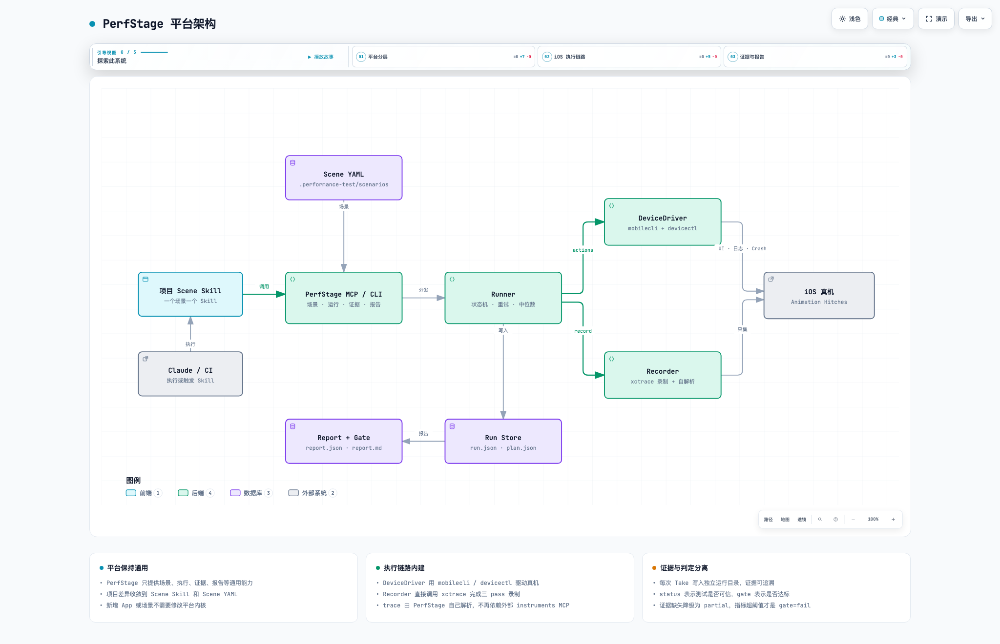
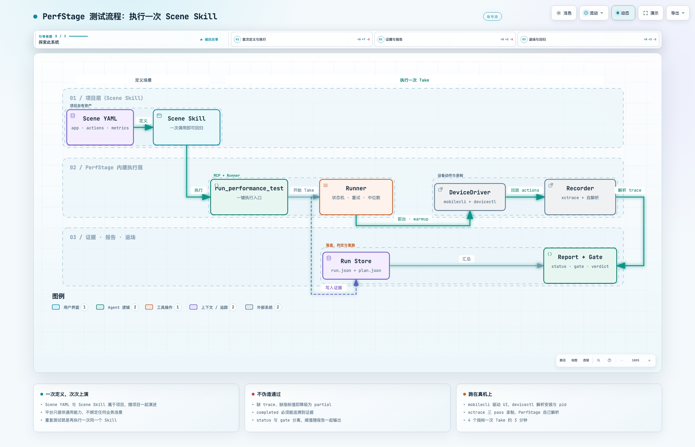

# PerfStage

**Define once. Perform every time.**
**一次定义，次次上演。**

PerfStage 是面向 iOS 的性能测试平台。它把 iOS 性能测试的通用能力收敛成一个稳定的 MCP 服务；每个接入项目基于这套能力，定义自己的测试场景和 Scene Skill。场景定义一次，之后每次回归只需要执行同一个 Skill。

> 平台是舞台，项目是剧目。PerfStage 提供灯光、音响和后台，项目负责写好自己的一场戏。

---

## 目录

- [1. 为什么是「平台 + 项目 Skill」](#1-为什么是平台--项目-skill)
- [2. 当前状态](#2-当前状态)
- [3. 快速开始](#3-快速开始)
- [4. 平台架构](#4-平台架构)
- [5. 一次 Take 的执行流程](#5-一次-take-的执行流程)
- [6. 项目 Scene Skill 契约](#6-项目-scene-skill-契约)
- [7. MCP 工具参考](#7-mcp-工具参考)
- [8. 场景 YAML 参考](#8-场景-yaml-参考)
- [9. 运行产物与报告](#9-运行产物与报告)
- [10. 状态语义](#10-状态语义)
- [11. 边界与路线图](#11-边界与路线图)
- [12. 常见问题](#12-常见问题)
- [13. 相关项目](#13-相关项目)

---

## 1. 为什么是「平台 + 项目 Skill」

不同 App 的性能场景差异很大：社区首页滚动、消息列表长按、直播间进出、启动首屏……这些知识属于业务，不属于平台。PerfStage 因此把职责分成三层：

| 层 | 归属 | 负责什么 |
| --- | --- | --- |
| **项目层** | 每个接入项目 | Scene YAML（场景定义）、Scene Skill（执行入口）、阈值与输出约定 |
| **平台层** | PerfStage | 场景解析、计划校验、运行生命周期、证据落盘、诊断归一化、报告生成 |
| **执行层** | iOS 工具链 | PerfStage 内建 Runner：`mobilecli` / `xcrun devicectl` 驱动设备，`xctrace` 录制 trace，PerfStage 自己解析（D13） |

这样分工带来两个直接好处：

- **平台不绑定业务。** 新增一个 App 或一个场景，不需要修改 PerfStage 内核。
- **重复测试成本极低。** 场景稳定后，回归就是「再执行一次 Skill」，而不是重新向助手描述一遍测试步骤。

### 产品定位与边界

PerfStage 是**平台**，不是某个 App 的测试脚本集合。能力归属如下：

| 能力 | 归属 | 具体内容 |
| --- | --- | --- |
| 驱动 | PerfStage | 解析场景、校验计划、按动作序列操作真机 |
| 采集 | PerfStage | 三 pass 录制（hitches / launch / memory），管理录制会话与 trace 保存 |
| 分析 | PerfStage | 解析 trace、归一化诊断、计算 verdict 与 `gate` |
| 报告 | PerfStage | `report.json` / `report.md` 与运行目录证据 |
| 场景 | 消费项目 | bundleId、动作、指标与阈值（`scenarios/*.yaml`） |
| 调用契约 | 消费项目 | Thin Skill（`SKILL.md`），说明 agent 如何调用一次工具 |

真实调用链只有一条：

```text
项目 SKILL.md ──读──▶ Agent ──调──▶ MCP 工具 run_performance_test
                                  或 CLI  perfstage run <sceneId>
                                        │
                                        ▼
                        驱动真机 → 采集 trace → 解析 → 报告
```

**边界要说清**：Skill 是 **agent 层**的调用契约，PerfStage 的输入始终是场景 ID（MCP 字段名 `scenarioId`，CLI 位置参数 `<sceneId>`）或 `adHocPlan`。Runner 不解析 `SKILL.md`，也没有 `perfstage run --skill` 这样的入口。这样 Skill 可以自由演进（调整措辞、补前置检查、改输出说明），平台只依赖稳定的工具入参与输出契约。

PerfStage **不负责**：业务断言、UI 正确性、多设备调度、托管服务、历史基线与趋势（最后一项在路线图中）。

### 命名约定

沿用舞台隐喻，文档和 Skill 中使用同一套词汇：

| 概念 | 叫法 | 说明 |
| --- | --- | --- |
| 平台 | **PerfStage** | 提供通用能力 |
| 项目场景 | **Scene** | 一个 YAML + 一个 Skill |
| 一次运行 | **Take** | 一次完整的测试执行 |
| 重复执行 | **Encore** | 复跑同一 Scene；阈值门禁已可用，历史对比规划中 |
| 项目场景集合 | **Repertoire** | 一个项目的全部 Scene |
| 报告 | **Scorecard** | `report.md` / `report.json` |

> 兼容性说明：运行时标识保持原样，MCP server 名仍是 `performance-test`，数据目录仍是 `.performance-test/`。PerfStage 是品牌与架构层，不要求迁移已有项目数据。

---

## 2. 当前状态

PerfStage 目前已经能**在真机上一键跑完一次 Take**：驱动设备、三 pass 录制、解析 trace、判定并出报告。还没有的是历史基线与回归对比。下面这张表区分「今天就能用」和「规划中」，避免把路线图当成现状。

| 能力 | 状态 | 说明 |
| --- | --- | --- |
| 场景加载与校验 | ✅ 可用 | YAML → TestPlan，未知动作直接报错 |
| 运行目录与证据落盘 | ✅ 可用 | 每次 Take 独立目录，路径边界与原子写 |
| 诊断归一化 | ✅ 可用 | 日志三态、Crash 差集、生命周期分类 |
| 证据门禁 | ✅ 可用 | 缺指标 / 缺值 / 缺 trace → `partial` + `gate=unknown` |
| 阈值判定与 `gate` | ✅ 可用 | 场景阈值自动推导 `pass` / `warn` / `fail` |
| 报告生成 | ✅ 可用 | `report.json` + 中文 `report.md` |
| 工作区隔离 | ✅ 可用 | 以项目为边界，不跨项目读写 |
| Skill 模板与契约 | ✅ 可用（Thin Skill） | `templates/SKILL.md`：Skill 只调用一次 `run_performance_test` |
| 一键执行 `run_performance_test` | ✅ 可用 | 内建 Runner：驱动真机、三 pass 录制、解析、收尾、报告 |
| CLI | ✅ 可用 | `perfstage init/list/run/report`，退出码 0/1/2/3 |
| 基线、历史对比 | ⏳ 规划中 | 当前只有单次报告与阈值门禁 |

**现在的真实执行链路是：**

```text
Scene Skill / CLI → run_performance_test → 设备动作 + 三 pass 录制 + 解析 + finalize → report
```

`prepare_performance_test` / `finalize_performance_test` 仍保留给需要人工接管的场景；
Runner 内部走的是同一条 `finalize` 流水线，所以两种入口的证据契约完全一致。

---

## 3. 快速开始

### 3.1 环境要求

- macOS + Xcode 命令行工具（`xctrace`）
- Node.js 20 或更高版本
- `mobilecli`（`npx @mobilenext/mobilecli`，或用 `PERFSTAGE_MOBILECLI` 指定路径）
- 一台已连接、已解锁的真实 iOS 设备；`Animation Hitches` 不支持模拟器

PerfStage 自带录制层与 trace 解析器，不再依赖 `instruments-mcp-server` 作为独立 MCP。

### 3.2 构建与注册

```bash
cd <perfstage-repo>          # 本仓库根目录
npm install
npm test
npm run build
```

以用户级方式注册到 Claude Code，一次安装、所有项目复用同一个入口：

```bash
claude mcp add --scope user --transport stdio performance-test -- \
  node "<perfstage-repo>/dist/index.js"
```

检查连接：

```bash
claude mcp list
```

用户级注册只共享**二进制入口**，不共享数据。每个项目仍然拥有自己的 `.performance-test/`。修改代码后需要 `npm run build` 并重启会话。

CLI 与 MCP 共用同一套实现。下面的 `perfstage` 命令都假设已经 `npm link`：

```bash
node dist/cli/bin.js --help
npm link                     # 之后可直接使用 perfstage
perfstage --help
```

### 3.3 初始化项目工作区

进入被测项目后，第一步永远是初始化：

```bash
perfstage init --app com.example.app --name "Example App" --copy-scenarios
```

等价于 MCP 的 `initialize_performance_workspace`：

```json
{
  "bundleId": "com.example.app",
  "appName": "Example App",
  "copyDefaultScenarios": true
}
```

- `bundleId` / `appName` 可选；不传则只创建默认目录。
- `copyDefaultScenarios: true` 会植入两个模板场景，适合首次试用。
- 初始化是**幂等**的，重复调用只重新校验，不覆盖已有配置与场景。

初始化后，项目的目录结构如下：

```text
<project>/
└── .performance-test/
    ├── config.json
    ├── scenarios/
    │   ├── scroll-baseline.yaml   # 仅 --copy-scenarios 时植入
    │   └── start-cold.yaml        # 仅 --copy-scenarios 时植入
    └── runs/
```

`init` 只负责工作区与场景，**不会生成 Skill**。需要 Skill 时，从
[`templates/SKILL.md`](templates/SKILL.md) 复制一份到项目的
`.claude/skills/<name>/SKILL.md`（或等价位置），再把场景 ID 与设备参数改成自己的。

### 3.4 定义一个 Scene

把场景写进 `.performance-test/scenarios/`（完整格式见[第 8 节](#8-场景-yaml-参考)），然后为它写一个 Skill（见[第 6 节](#6-项目-scene-skill-契约)）。

### 3.5 执行

命令行一次 Take（`<sceneId>` 取自 `perfstage list`）：

```bash
perfstage run <sceneId> --device <UDID>
perfstage run <sceneId> --device <UDID> --json
perfstage report <runId>
```

或者对 Claude 说：

```text
执行 perf-community-scroll
```

Skill 只调用一次 `run_performance_test`，Runner 完成设备动作、三 pass 录制、
trace 解析、证据门禁与报告。需要回归时再说一次，就是一次 Encore。

退出码：`0` 有效且未越阈值 · `1` 有效但 `gate=fail`（`--strict` 时 `warn` 也算）·
`2` 测试本身不可信 · `3` 环境/配置错误。

---

## 4. 平台架构



- 交互式版本（可切换视图、明暗主题）：[`docs/diagrams/perfstage-architecture.html`](docs/diagrams/perfstage-architecture.html)
- 源文件：[`docs/diagrams/perfstage-architecture.json`](docs/diagrams/perfstage-architecture.json)

**读图要点：**

- **项目 Scene Skill** 是 agent 的入口：它属于项目，随项目一起版本化；人也可以直接用 CLI 执行同一个场景。
- **PerfStage MCP** 是通用能力层：加载场景、校验计划、管理运行、落盘证据、生成报告。
- **Runner** 是内建执行器。它把一次调用展开为「准备设备 → 按指标录制 → 回放动作 → 解析 trace → 收尾」，重复测试不再依赖现场编排。
- **Device Driver / Recorder** 是执行层适配器：`mobilecli` + `xcrun devicectl` 驱动设备，`xctrace` 录制 trace；PerfStage 自己解析 trace（D13），不依赖外部 instruments MCP。
- **Run Store / Report + Gate** 是证据层。每次 Take 都写入独立目录，报告可追溯。

平台当前已具备图中执行链与门禁；基线对比仍为规划中能力。

---

## 5. 一次 Take 的执行流程



- 交互式版本：[`docs/diagrams/perfstage-workflow.html`](docs/diagrams/perfstage-workflow.html)
- 源文件：[`docs/diagrams/perfstage-workflow.json`](docs/diagrams/perfstage-workflow.json)

一次 Take 分为四段：

1. **定义**：Scene YAML 描述 App、前置条件、warmup、actions、metrics；Scene Skill 描述如何执行它。
2. **执行**：`run_performance_test` 准备设备与 App，让 `xctrace --launch` 冷启动 App，warmup 在录制内、动作时间窗之前执行。
3. **采集**：按指标录制 Hitches / App Launch / Activity Monitor；动作在卡顿 pass 内回放，同时保存日志、Crash 与生命周期证据。
4. **判定**：`finalize` 解析 trace、汇总证据、计算阈值门禁并生成报告。证据不足即降级为 `partial`（`gate=unknown`），指标超阈值则是 `completed` + `gate=fail`。

**返场（Encore）** 是同一个流程的再次执行。阈值门禁已经接在报告之后，规划中的基线对比会进一步判断本次相对历史是否回归。

---

## 6. 项目 Scene Skill 契约

Skill 是项目资产，不是平台资产。它应该足够短：只描述「测什么、在哪台设备上测、结果怎么算」，不重复平台的编排细节。

### 6.1 目录约定

```text
<project>/.claude/skills/perf-<scene>/
├── SKILL.md          # 必须
└── references/       # 可选：截图、预期结果、历史结论
```

### 6.2 输入契约

一个 Scene Skill 至少接收：

| 输入 | 必填 | 说明 |
| --- | --- | --- |
| `sceneId` | 是 | 场景 ID，对应 `.performance-test/scenarios/<sceneId>.yaml`；调用工具时字段名是 `scenarioId` |
| `deviceId` | 是 | 目标设备 UDID；不要写死在 YAML 里 |
| `analysisFocus` | 否 | 例如 `["jank", "memory"]`，覆盖场景默认值 |
| `baselineRunId` | 否 | 规划中：指定对比基线 |

### 6.3 输出契约

无论底层如何实现，Skill 最终都应返回同一组字段（这正是 `run_performance_test` 的返回形状）：

```jsonc
{
  "runId": "2026-11-13T06-20-00.000Z-a1b2",
  "scenarioId": "community-home-scroll",
  "status": "completed",
  "gate": "pass",
  "metrics": [
    { "name": "hitches", "value": 3, "unit": "次", "verdict": "pass", "tracePath": "traces/hitches.trace" },
    { "name": "blockMs", "value": 84.2, "unit": "ms", "verdict": "pass", "tracePath": "traces/hitches.trace" },
    { "name": "launchMs", "value": 274.3, "unit": "ms", "verdict": "pass", "tracePath": "traces/launch.trace" },
    { "name": "memoryMB", "value": 113.5, "unit": "MB", "verdict": "pass", "tracePath": "traces/memory.trace" }
  ],
  "actions": [{ "actionId": "scroll-up-1", "outcome": "executed" }],
  "passes": [{ "template": "hitches", "tracePath": "traces/hitches.trace", "attempts": 1, "durationMs": 21000, "errorCount": 0, "warningCount": 1 }],
  "findings": [],
  "notes": [],
  "durationMs": 188000,
  "reportPath": ".performance-test/runs/<runId>/report.json",
  "reportMarkdownPath": ".performance-test/runs/<runId>/report.md",
  "repetitionCount": 1
}
```

- `status`：`completed` / `partial` / `failed` / `invalid` / `cancelled`
- `gate`：阈值门禁结果 `pass` / `warn` / `fail` / `unknown`

`status` 与 `gate` 回答两个不同问题：`status` 表示这次 Take 是否有效可信，
`gate` 表示指标是否达标。指标超过阈值时仍是 `status=completed` +
`gate=fail`，不会把测试本身判成 `partial`。

指标名使用 MVP 规范词表（`hitches` / `blockMs` / `launchMs` / `memoryMB`），
旧名 `memory`、`launch`、`blockingMs` 会被自动归一化。每个指标都应带
`tracePath`，否则证据门禁会认为本次 Take 不完整。

### 6.4 示例 `SKILL.md`

> 这是**当前可执行**的 Thin Skill 形态：Skill 只调用一次 `run_performance_test`，
> 编排、录制、解析与报告都在 Runner 内部完成。

```markdown
---
name: perf-community-scroll
description: 社区首页上下滚动性能测试。用于回归卡顿、冷启动与内存。
---

# 社区首页滚动性能测试

## 参数
- sceneId: community-home-scroll
- deviceId: 必填，向用户确认或从 `xcrun devicectl list devices` 中选择

## 步骤
1. 调用 `run_performance_test`：
   `{ "scenarioId": "community-home-scroll", "device": { "id": "<deviceId>" } }`
2. 把返回值原样汇报给用户：`runId`、`status`、`gate`、四个指标、
   `findings`、`reportPath`。
3. 若 `status` 不是 `completed`，逐条列出 `findings` 与缺失证据；
   不要重跑后复用旧结果，也不要手工补指标值。

> 完整可复制版本见 [`templates/SKILL.md`](templates/SKILL.md) 与
> [`examples/skills/perf-community-scroll/SKILL.md`](examples/skills/perf-community-scroll/SKILL.md)。
```

需要人工接管的场景（例如自定义录制窗口）仍可走 `prepare_performance_test` →
自行采集 → `finalize_performance_test`，两条路径共享同一个证据门禁。

### 6.5 编写 Skill 的三条规则

1. **不要伪造证据。** 没采到 trace 就如实报告，让状态降级为 `partial`。
2. **不要在 Skill 里写设备 UDID。** 设备是运行时参数，不是场景定义。
3. **不要把业务判断写进平台。** 阈值、关注点和结论属于项目，平台只负责计算与呈现。

---

## 7. MCP 工具参考

PerfStage 提供 6 个工具。`run_performance_test` 是一键入口；
`prepare` / `finalize` 是保留给人工接管与排障的底层原语，两者共享同一条证据流水线。

### `run_performance_test`

执行一次完整 Take：解析场景或临时计划、驱动真机、按指标录制 1–3 个 pass、
解析 trace、做证据门禁并写出报告。

```json
{
  "scenarioId": "community-home-scroll",
  "device": { "id": "00008150-001E49E40128C01C" },
  "repetitions": 3
}
```

也可以用 `adHocPlan` 代替 `scenarioId`。返回 `runId`、`status`、`gate`、
`metrics`（含 `verdict` 与 `tracePath`）、`actions`、`passes`、`findings`、
`notes`、`reportPath`、`reportMarkdownPath`。

- `repetitions > 1` 时逐轮执行，指标取中位数，原始样本保留在 `samples`。
- 场景的 `warmup` 在 hitches 录制内、动作时间窗之前执行，因此不会被计入 `hitches` / `blockMs`；`actions` 只在卡顿 pass 的动作时间窗内回放。
- 阈值缺失时 `gate` 由已有阈值推导；全部缺失则为 `unknown`。

### `initialize_performance_workspace`

在当前项目创建或校验 `.performance-test/`。幂等，不覆盖已有数据。

### `list_performance_scenarios`

列出当前项目的场景：ID、名称、Bundle ID、动作数量、指标、分析重点。无参数。

### `prepare_performance_test`

创建一次运行（`prepared` 状态），写入 `run.json` 和解析后的 `plan.json`，返回执行指引。

```json
{
  "scenarioId": "community-home-scroll",
  "device": { "id": "00008150-001E49E40128C01C", "name": "Ra iPhone" },
  "execution": "interactive",
  "analysisFocus": ["jank", "memory"]
}
```

返回字段：`runId`、`scenarioId`、`planId`、`runPath`、`planPath`、`plan`、`execution`、`analysisFocus`、`metricOverrides`、`nextSteps`。

`plan` 是完整解析后的 `TestPlan`，Skill 与 CLI 无需再读取文件布局即可执行本次 Take。

也可以传 `adHocPlan` 做一次性测试；临时计划不会自动沉淀为长期场景。

### `analyze_performance_trace`

用 PerfStage 自己的解析器读取 xctrace，返回 `finalize_performance_test`
可直接消费的规范指标。这是 D13 的落地：录制只负责产出 `.trace`，
解析与口径全部归 PerfStage。

```json
{
  "template": "hitches",
  "tracePath": "/tmp/take-hitches.trace",
  "processName": "NN"
}
```

| `template` | 产出指标 | 关键参数 |
| --- | --- | --- |
| `hitches` | `hitches`、`blockMs` | 可选 `table`（默认 `hitches-frame-lifetimes`） |
| `launch` | `launchMs` | `processName`（默认选启动进程） |
| `memory` | `memoryMB` | `processName: "NNIM"` 或 `pid` |

返回 `metrics` 数组（含 `unit`、`instrument`、`tracePath`）以及精简后的
`analysis` 与 `warnings`。指标没有值时不会补 0，交给证据门禁判 `partial`。

指标口径：

- `hitches` 是**卡顿帧数**：非绿色帧，加上时长超过中位帧 1.3 倍的绿色帧。
  它不是 sparse hang 事件数，数量通常大一个量级。
- `blockMs` 是这批卡顿帧里最长的一帧时长，与 `hitches` 共用同一条 trace。
- `memoryMB` 取目标进程 `phys_footprint` 的中位数，不是峰值。
- `launchMs` 取 `life-cycle-period` 的首尾跨度；没有生命周期行时不补 0。

### `finalize_performance_test`

提交动作、指标和诊断证据，计算最终状态并生成报告。

```json
{
  "runId": "2026-11-13T06-20-00.000Z-a1b2",
  "requestedStatus": "completed",
  "actions": [
    {
      "actionId": "scroll-up-1",
      "outcome": "executed",
      "startedAt": "2026-11-13T06:20:10.000Z",
      "endedAt": "2026-11-13T06:20:11.500Z",
      "durationMs": 1500
    }
  ],
  "metrics": [
    {
      "name": "hitches",
      "value": 3,
      "unit": "frames",
      "verdict": "warn",
      "tracePath": "/tmp/community-hitches.trace"
    }
  ],
  "diagnostics": {
    "logText": "...device log text...",
    "crashIdsBefore": ["old-crash-id"],
    "crashIdsAfter": ["old-crash-id"],
    "crashReports": [],
    "lifecycle": [{ "kind": "foreground", "timestamp": "2026-11-13T06:20:00.000Z" }]
  },
  "evidencePaths": [
    { "kind": "deviceLog", "sourcePath": "/tmp/device.log", "relativePath": "device.log" }
  ],
  "notes": "重点观察减速尾段。"
}
```

规则：

- `requestedStatus` 必须是终态；`prepared` / `running` 会被拒绝。
- 证据会复制进运行目录，报告中只出现相对路径。
- 查询失败必须填写对应的 `*QueryError`，不能伪造为空结果。
- 新增 Crash、watchdog、jetsam、设备断连都会阻止结果被标记为普通成功。
- **证据门禁已强制**：计划中的指标必须全部出现、必须有值；由 Instruments
  生产的指标还必须有 `tracePath`。任一缺失都会把 `status` 降为 `partial`、`gate` 置为 `unknown`。
- **阈值自动判定**：`value` + `threshold` 会推导 `verdict`（`fail` > `warn` > `pass`）；
  阈值来自场景/计划，指标结果只需携带测量值。
- **`status` 与 `gate` 分离**：指标超过 `fail` 阈值时返回 `status=completed` + `gate=fail`；
  证据不完整才是 `status=partial`。

---

## 8. 场景 YAML 参考

场景文件位于 `<project>/.performance-test/scenarios/`：

```yaml
id: community-home-scroll
name: 社区首页来回滚动
app:
  bundleId: com.example.app
device: {}
preconditions:
  foregroundBundleId: com.example.app
  accessibilityText: 社区
warmup:
  - id: open-community
    type: tap
    target: 社区
    waitAfterMs: 1500
actions:
  - id: scroll-up-1
    type: swipe
    direction: up
    distance: 700
    durationMs: 500
    waitAfterMs: 1500
  - id: scroll-down-1
    type: swipe
    direction: down
    distance: 700
    durationMs: 500
    waitAfterMs: 1500
metrics:
  - name: hitches
    instrument: Animation Hitches
    threshold: { warn: 3, fail: 5 }
  - name: blockMs
    instrument: Animation Hitches
    threshold: { warn: 50, fail: 100 }
  - name: launchMs
    instrument: App Launch
    threshold: { warn: 400, fail: 800 }
  - name: memoryMB
    instrument: Activity Monitor
    threshold: { warn: 200, fail: 320 }
```

`hitches` 与 `blockMs` 来自同一次 Animation Hitches 采集；`launchMs` 与
`memoryMB` 分别来自 App Launch 与 Activity Monitor。MVP 规范词表见
`src/analysis/metrics.ts`。仓库内的示例场景已迁移到这四个指标，Allocations
在 Xcode 27.2 + iOS 27 上不可用，已不再使用。

支持的动作类型：

| 类型 | 说明 |
| --- | --- |
| `tap` | 按 accessibility 文本或元素目标点击 |
| `swipe` | 指定方向、距离、可选持续时间 |
| `wait` | 等待指定毫秒数 |
| `wait_for` | 等待元素出现，直到超时 |

约定：

- 不要在长期场景里写设备 UDID，设备通过 `prepare_performance_test` 传入。
- 未知动作会导致加载失败，不会静默跳过。
- 场景目前不做版本管理，修改 YAML 即生效。

---

## 9. 运行产物与报告

每次 Take 写入当前项目的独立目录：

```text
<project>/.performance-test/runs/<run-id>/
├── run.json                 # 运行状态、动作、指标、notes 与证据路径字段
├── plan.json                # 本次解析后的完整 TestPlan（不含诊断配置）
├── report.json              # 机器可读报告
├── report.md                # 中文 Markdown 报告
├── device.log               # 设备日志（默认采集；日志流无输出时不存在）
└── traces/                  # xctrace 原始产物
    ├── hitches.trace
    ├── launch.trace
    └── memory.trace
```

Crash 差集与生命周期分类写入 `report.json` 的 `diagnostics`（含降级结论与 Crash ID），
运行目录不单独落盘；`run.json.notes` 只记录执行备注与失败归因。v0.1 不采集网络抓包，
也不会在失败时生成截图，因此没有对应的目录。

`report.json` 不重复内联 `device.log` 的正文，只保留分类统计与 `lineCount`，
原始文本由 `evidencePaths.deviceLog` 指向。`repetitions > 1` 时，
`metrics[].samples` 保留每一轮的原始样本，顶层值是中位数。

查看最近一次报告：

```bash
find .performance-test/runs -name report.md -type f -print | sort | tail -1
```

运行目录是**证据**，不是测试管理数据库。确认不再需要后可以手动删除。平台永远不会把 A 项目的报告写进 B 项目。

---

## 10. 状态语义

| 状态 | 含义 |
| --- | --- |
| `prepared` | 已创建运行与计划，尚未执行 |
| `completed` | 指标与诊断证据齐全，且无稳定性问题 |
| `partial` | 部分指标、日志或证据缺失，或存在 warning |
| `failed` | 流程中断、设备断连、Crash、watchdog、jetsam 等 |
| `invalid` | 前置条件、场景结构、参数或证据格式不合法 |
| `cancelled` | 主动终止 |

平台的判定原则是：`completed` 必须建立在**可追溯的证据**上。如果一个指标没有值或没有 trace，结果就会被降级为 `partial` 且 `gate=unknown`——这是重复测试可信度的底线，已经由 `finalize` 强制。

---

## 11. 边界与路线图

### 当前边界

- **iOS only。** 动作模型面向 iOS accessibility，不承诺 Android / Web / 桌面。
- **单项目、本地。** 工作区即项目边界，不包含多租户、数据库、团队权限或 Web 控制台。
- **执行已内建，但只支持单设备串行。** Runner 一次跑一个 Take；没有调度器、并发或设备池。
- **只有单次报告。** 没有历史索引、基线、趋势与 CI 门禁。
- **阈值已自动判定。** `threshold` 会推导 `verdict` 并汇总为 `gate`；基线对比仍属规划。

### 路线图

完整的 MVP 范围、里程碑、任务清单与验收标准见 **[`docs/mvp-plan.md`](docs/mvp-plan.md)**。

**第一阶段：让一次 Take 可重复**

- [x] 固化 Scene Skill 模板与输出契约（本文第 6 节）
- [x] `prepare_performance_test` 返回完整解析计划
- [x] `finalize_performance_test` 证据硬校验：缺 trace / 缺值不得 `completed`
- [x] 阈值 verdict 与 `gate`，并把 `status` 与 `gate` 分离
- [x] 用真实场景连续跑 3 次，记录状态与指标波动（`docs/m2-validation.md`）

**第二阶段：让一次 Take 自动化**（已完成）

- [x] 实现 `run_performance_test` 高层工具
- [x] 内建 Device Driver 与 xctrace Recorder（`mobilecli` / `devicectl` / `xctrace`）
- [x] 落地 `running` 状态与 `repetitions` 中位数聚合
- [x] 结构化输出稳定为 `status / metrics / findings / reportPath / gate`
- [x] CLI：`perfstage init/list/run/report`，退出码可被脚本消费
- [x] 真机矩阵：2 个场景 × 3 次（6/6 `completed`，同一固定构建；结果见 `docs/m3-validation.md` §2/§3）

**第三阶段：让重复测试有意义**

- [ ] 运行历史索引与查询
- [ ] 基线管理与两次 Take 的指标对比
- [ ] 回归门禁与趋势
- [ ] 阶段归因（动作区间 / 惯性 / 动作后 / unknown）

---

## 12. 常见问题

**工具没有出现**

```bash
npm run build
claude mcp list
```

确认注册命令里的 `dist/index.js` 是绝对路径，然后重启会话。

**提示工作区未初始化**

当前目录下没有 `.performance-test/config.json`。先调用 `initialize_performance_workspace`。MCP 不会回退到安装目录或其他项目。

**找不到场景**

确认场景文件在 `.performance-test/scenarios/` 下，再调用 `list_performance_scenarios` 查看实际加载结果。未知动作会导致整个场景加载失败。

**报告是 `partial` 而不是 `completed`**

查看 `report.md` 的「稳定性诊断」和「限制与未知项」。常见原因是日志 / Crash 查询失败、指标缺少 trace 或诊断证据不完整。

**设备日志为空**

Runner 在第一次录制前就启动日志流，所以正常情况下不会为空。若仍为空，先确认
`mobilecli device logs --filter process=<可执行名>` 能取到日志：过滤用的是
**可执行文件名**（NN 是 `NNIM`），不是 App 显示名（`NN`）。显示名会静默返回零行。

**新增了 Crash**

查看 `report.md` 的稳定性诊断段与 `report.json` 的 `diagnostics.crashes`。新增 Crash 会让状态降级，报告会列出 Crash ID、异常信息和降级原因。

**真机上某次 Take 失败**

依次检查设备是否解锁、App 是否仍在安装、USB 是否松动。常见信号：

- `_lockKPerf: could not lock kperf`：上一次录制没有释放锁，Runner 会自动重试 3 次（每次间隔 30 秒）。
- `devicectl ... error 4016`：设备已断开，本次 Take 判失败，但报告仍会落盘。
- 启动类计划结束 App 会退到后台，这是 `xctrace --launch` 的行为，不是测试失败。
- **hitches pass 用 `xctrace --launch` + 动作时间窗，不再 `--attach <pid>`**
  （D15）。录制前 Runner 会先 terminate，让 xctrace 冷启动 App；指标只统计
  actions 所在的时间窗，因此冷启动的卡顿帧不会算进 `hitches` / `blockMs`。
  这也意味着 `Cannot find process for provided pid` 不会再出现在一键执行里。
  仍可能出现的是：
  - **同名可执行文件在跑**：例如同时装了 `com.nndev.im` 和另一份 NN，两者的进程名
    都是 `NNIM`。hitches pass 不受影响；**memory pass** 按容器 UUID 从进程表选择
    目标，同名并存属于正常情况，不会再报 `duplicate-process`。只有当容器 UUID
    在进程表中找不到时，才会取不到 pid。
  - **`--launch` 在 App 已运行时挂住**：极少数情况下 xctrace 会停在
    “Launching process” 不再进入录制。录制层会在超时后先 SIGINT、宽限期后再
    强制结束，并按既有重试策略再录一次；没有 trace 的 Take 一律不会记成成功。
- `Cannot find process matching name` 只会出现在手动用 `--attach` 调用底层
  录制 API 时；Runner 的一键执行路径不会走到这里。
- `timed out waiting for WebDriverAgent to be ready`：手机重启后 `mobilecli` 守护进程还握着旧的
  隧道。执行 `mobilecli daemon stop`，下一条命令会自动用新隧道重启守护进程。

**手机重启后必须重启 `mobilecli` 守护进程**

`mobilecli` 的守护进程会长期持有 iOS 隧道与设备侧 agent。设备重启后这条隧道失效，但守护进程
不知道，表现为 `apps foreground` 报 `timed out waiting for WebDriverAgent to be ready`——
`apps launch` 却仍然成功，很容易误判成 App 的问题。执行一次
`mobilecli daemon stop` 即可恢复。

**报错 `did not reach the foreground within 20000ms`**

先看错误信息末尾的 `foreground was …`：它指出当时真正在前台的是谁。真机上最常见的原因是
**别的 App 的系统弹窗盖在上面**（本地网络、通知授权），典型形态是
`com.apple.springboard (UIEditingOverlayViewController)`。此时 App 已经启动，只是抢不到前台，
在手机上点掉那个弹窗再重跑即可。Runner 会等到超时才失败，不会把这种 Take 记成有效结果。

**在项目 A 执行，报告却写到了项目 B**

不应发生。确认会话是在项目 A 目录下启动、项目 A 已初始化，并且不要用同一个会话跨目录复用。

---

## 13. 相关项目

- [`mobilecli`](https://www.npmjs.com/package/@mobilenext/mobilecli)：设备与 UI 自动化（Runner 的 Device Driver 后端）
- [`mobile-mcp`](https://github.com/mobile-next/mobile-mcp)：同类设备自动化能力，M0 阶段的参考实现
- [`../instruments-mcp-server/`](../instruments-mcp-server/)：M0 阶段的 Instruments 采集适配器，录制层已内化
- [`docs/platform-capability-review.md`](docs/platform-capability-review.md)：平台能力复盘与评分
- [`docs/mvp-plan.md`](docs/mvp-plan.md)：MVP 范围、里程碑、任务与验收标准
- [`docs/m3-validation.md`](docs/m3-validation.md)：M3 真机矩阵（Runner 一键执行）与指标波动
- [`docs/spikes/m0-device-spike.md`](docs/spikes/m0-device-spike.md)：M0 真机验证结论与指标可行性
- [`docs/diagrams/`](docs/diagrams/)：架构图与流程图源文件、交互式 HTML
- [`docs/superpowers/specs/2026-10-17-performance-test-mcp-design.md`](docs/superpowers/specs/2026-10-17-performance-test-mcp-design.md)：原始设计文档
- [`docs/superpowers/verification/2026-10-17-interactive-run.md`](docs/superpowers/verification/2026-10-17-interactive-run.md)：交互式流程验证记录
